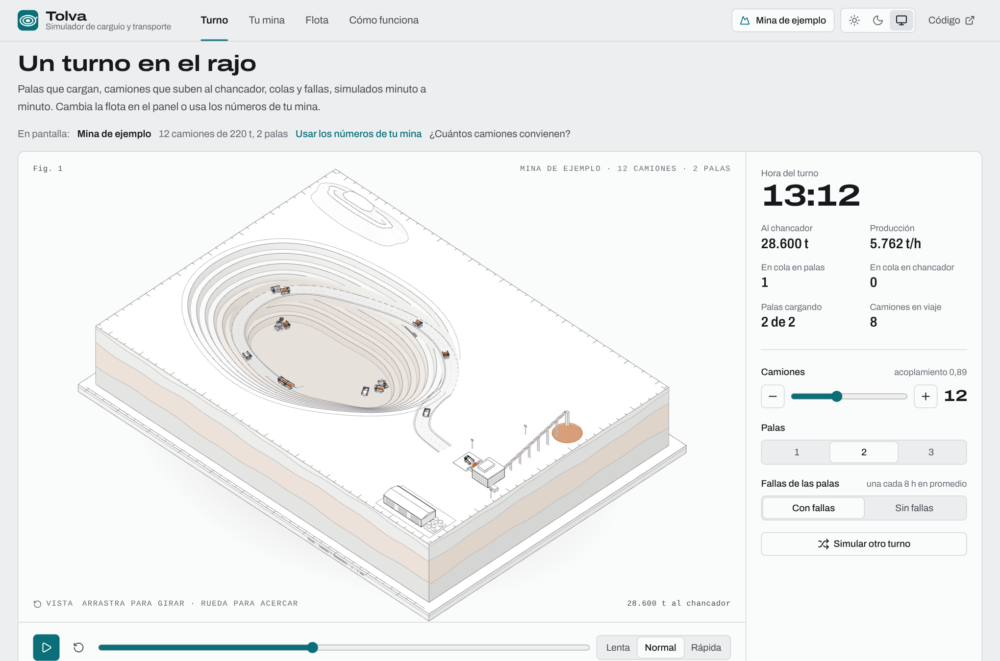
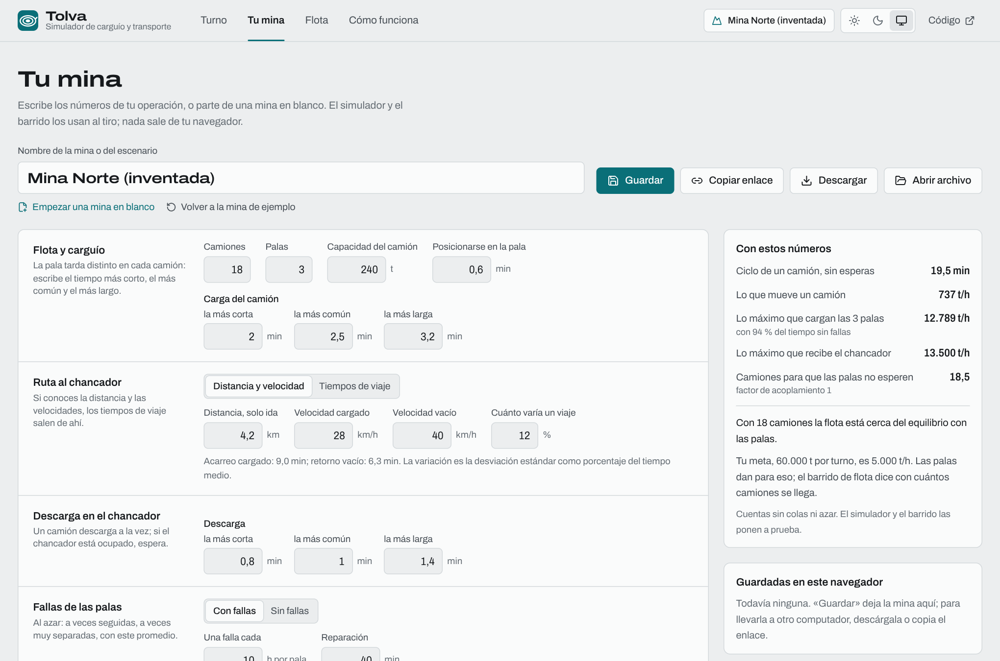
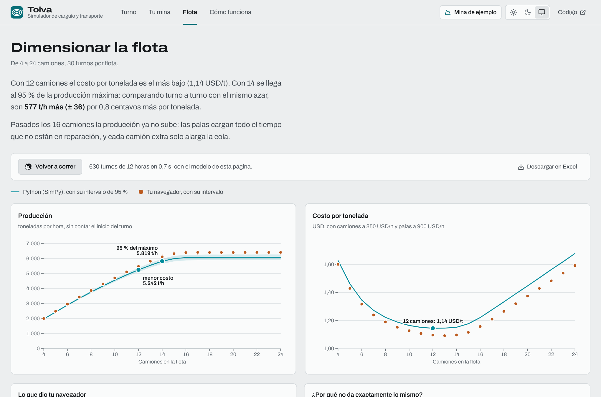
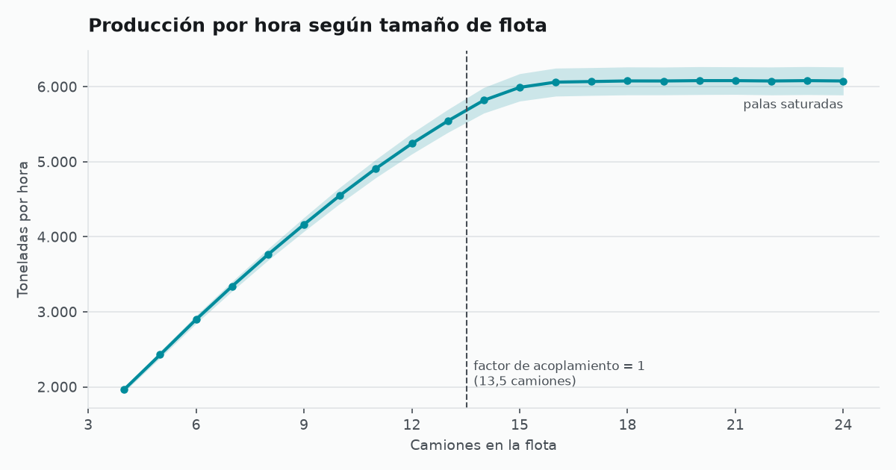
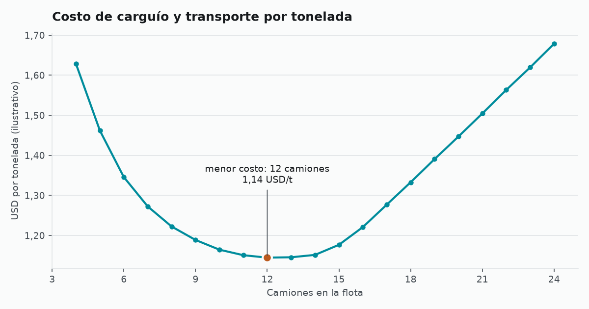
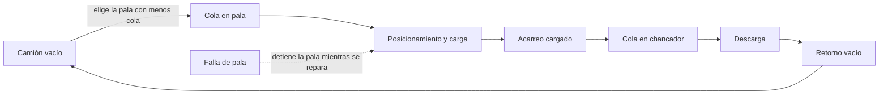

<div align="center">

# Tolva: simulación de carguío minero

**¿Cuántos camiones necesita una mina a rajo abierto?**<br>
Una simulación de eventos discretos con palas, camiones, un chancador y fallas, que se puede mirar turno a turno y responde con producción, colas y costo por tonelada.

[**Abrir Tolva**](https://vewachholtz-ops.github.io/simulacion-carguio-minero/) | [**Tu mina**](https://vewachholtz-ops.github.io/simulacion-carguio-minero/#mina) | [Resultados](#resultados) | [El modelo](#el-modelo) | [Cómo se verifica](#cómo-se-verifica) | [Correrlo en tu computador](#correrlo-en-tu-computador)

[](https://github.com/vewachholtz-ops/simulacion-carguio-minero/actions/workflows/ci.yml)


[](LICENSE)

<sub><i>Discrete-event simulation of an open-pit shovel–truck system (SimPy) to size the truck fleet, with replications, confidence intervals and a cost-per-tonne analysis, plus a web app that animates a shift and runs the fleet sweep in the browser.</i></sub>

<picture>
  <source media="(prefers-color-scheme: dark)" srcset="docs/rajo-oscuro.png">
  
</picture>

</div>

## Qué hace

**Dimensiona la flota.** Prueba de 4 a 24 camiones: con 12 el costo por tonelada es mínimo (1,14 USD/t) y con 14 se llega al 95 % de la producción máxima.

**Con la variabilidad de una operación real.** Tiempos de carga y de viaje aleatorios, fallas de las palas, 30 turnos por flota e intervalos de confianza de 95 %.

**Compara flotas turno a turno.** Las dos flotas usan los mismos números aleatorios, así la diferencia es precisa: pasar de 12 a 14 camiones suma 577 ± 36 t/h.

**Con los números de tu mina.** En «Tu mina» escribes tu operación (camiones, palas, capacidad, tiempos de carga, distancia y velocidades al chancador, fallas, turno, costos y una meta de toneladas), o partes de una mina en blanco. El simulador y el barrido se recalculan con ella; la guardas en el navegador, la compartes con un enlace, comparas dos escenarios con el mismo azar y descargas todo en Excel. El mismo archivo del escenario corre en Python: `uv run carguio --escenario mi-mina.json`.

**Se puede mirar.** La app muestra el turno en una maqueta 3D de la mina: el rajo con sus bancos y su rampa, cada camión subiendo cargado (con el mineral en la tolva) o bajando vacío, las palas girando para cargar, las colas, las fallas, el camión que vacía en el chancador y el acopio que crece con las toneladas. Se gira y se acerca con el mouse. Cambias camiones, palas o fallas y el turno se vuelve a simular al tiro.

## La app

[Tolva](https://vewachholtz-ops.github.io/simulacion-carguio-minero/) es una página estática, sin servidor: nada de lo que escribes sale de tu navegador. Se abre en el turno y tiene cuatro pestañas:

- **Turno:** la maqueta 3D de la mina con el turno en movimiento, la bitácora de las palas y el chancador, y los controles (camiones, palas, fallas, velocidad, otro turno).
- **Tu mina:** los números de una operación propia, agrupados como se piensan en terreno; la ruta se puede dar como distancia y velocidades. Al lado, las cuentas que salen directo de esos números (ciclo, lo que mueve un camión, lo máximo que cargan las palas y recibe el chancador, los camiones para el equilibrio) y si la meta es alcanzable. Se guarda en el navegador, se comparte con un enlace (la mina va dentro de la dirección), se descarga como JSON y se abre de vuelta. Debajo, **comparar dos escenarios**: los dos corren los mismos turnos de azar y la tabla muestra la diferencia con su intervalo de 95 %, descargable en Excel.
- **Dimensionar la flota:** con la mina de ejemplo, la producción y el costo por tonelada de 4 a 24 camiones publicados por la versión Python y un botón que corre los mismos 630 turnos en tu navegador; con tu mina, el barrido alrededor de su equilibrio, la flota de menor costo, la que llega al 95 % del máximo y la que cumple la meta. Todo se descarga en Excel.
- **Cómo funciona:** el ciclo del camión, las decisiones de modelamiento y los parámetros de la mina en pantalla.

La maqueta está hecha con three.js y sigue el acabado de las figuras de [Anatomy](https://github.com/wheresryan22/anatomy) (MIT): sólidos color papel con un tono por cara según hacia dónde mira, líneas finas en tres tonos y color solo donde importa: el mineral de cobre y las fallas. Es una sola mina dibujada para cualquier escenario; lo que cambia con tus números son la flota, las palas, los tiempos y lo que hace cada equipo en cada minuto.

El modelo de la app es el de [`src/carguio/modelo.py`](src/carguio/modelo.py), escrito otra vez en TypeScript ([`interfaz/src/modelo/`](interfaz/src/modelo/)) para que corra rápido en el navegador y se pueda animar. Las dos versiones usan generadores de azar distintos, así que no dan los mismos turnos: dan los mismos promedios y la misma variación, y las pruebas lo comprueban (ver [Cómo se verifica](#cómo-se-verifica)).

<picture>
  <source media="(prefers-color-scheme: dark)" srcset="docs/mina-oscuro.png">
  
</picture>

<picture>
  <source media="(prefers-color-scheme: dark)" srcset="docs/flota-oscuro.png">
  
</picture>

## Resultados

<picture>
  <source media="(prefers-color-scheme: dark)" srcset="resultados/produccion-oscuro.png">
  
</picture>

Con 2 palas, camiones de 220 t y un chancador (parámetros ilustrativos, ver más abajo):

| Camiones | Factor de acoplamiento | Producción (t/h) | IC 95 % | % del máximo | Palas cargando (% del turno) | Espera en pala (min) | Costo (USD/t) |
|---:|---:|---:|---:|---:|---:|---:|---:|
| 8 | 0,59 | 3.763 | ± 76 | 61,9 % | 56 % | 1,7 | 1,22 |
| 10 | 0,74 | 4.551 | ± 108 | 74,8 % | 67 % | 2,7 | 1,16 |
| **12** | **0,89** | **5.242** | **± 139** | **86,2 %** | **77 %** | **3,9** | **1,14** |
| 13 | 0,96 | 5.543 | ± 153 | 91,2 % | 81 % | 4,6 | 1,15 |
| **14** | **1,04** | **5.819** | **± 170** | **95,7 %** | **85 %** | **5,4** | **1,15** |
| 15 | 1,11 | 5.991 | ± 183 | 98,5 % | 88 % | 6,7 | 1,18 |
| 16 | 1,18 | 6.061 | ± 187 | 99,7 % | 89 % | 8,5 | 1,22 |
| 18 | 1,33 | 6.077 | ± 186 | 99,9 % | 89 % | 12,8 | 1,33 |
| 20 | 1,48 | 6.081 | ± 186 | 100,0 % | 89 % | 17,1 | 1,45 |

Tabla completa (4 a 24 camiones): [`resultados/barrido-flota.csv`](resultados/barrido-flota.csv). El intervalo de confianza es amplio (± 3 %) porque las fallas de pala hacen que un turno sea muy distinto de otro.

**Lo que muestra la simulación:**

1. **La producción crece casi en línea recta hasta unos 15 camiones y después se estanca en unas 6.080 t/h.** Desde ahí el cuello de botella son las palas: cargan el 89 % del turno, que es todo el tiempo que no están en reparación (las fallas las detienen un 11 % del turno en promedio).
2. **La fórmula del factor de acoplamiento se queda corta.** El cálculo determinista dice que la flota está equilibrada con 13,5 camiones. Con la variabilidad de los tiempos y las fallas, 14 camiones logran el 95,7 % de la producción máxima y hacen falta 16 para pasar el 99 %.
3. **La flota más barata no es la que más conviene.** El menor costo por tonelada está en 12 camiones (1,14 USD/t). Pero, comparando turno a turno con los mismos números aleatorios, **14 camiones producen 577 t/h más (+11 %, IC 95 %: ± 36) y cuestan solo 0,8 centavos más por tonelada (+0,7 %, IC 95 %: ± 0,5 centavos)**. Si el plan minero necesita esas toneladas, 14 es la mejor opción; si sobra capacidad aguas abajo, 12.
4. **Desde unos 17 camiones, cada camión extra casi solo agrega cola.** Entre 17 y 24 camiones la producción sube menos de 0,2 %, mientras la espera en pala pasa de 11 a 26 minutos por ciclo.

<picture>
  <source media="(prefers-color-scheme: dark)" srcset="resultados/costo-oscuro.png">
  
</picture>

## El modelo



| Parámetro | Valor por defecto | Distribución |
|---|---|---|
| Palas / chancadores | 2 / 1 | — |
| Capacidad del camión | 220 t | — |
| Posicionamiento en pala | 0,7 min | fijo |
| Carga | 2,5 – 3,0 – 4,0 min | triangular (mín, moda, máx) |
| Acarreo cargado | media 12 min, desviación 1,5 | normal, acotada a no menos del 10 % de la media |
| Descarga en chancador | 1,0 – 1,2 – 1,6 min | triangular |
| Retorno vacío | media 9 min, desviación 1 | normal, acotada a no menos del 10 % de la media |
| Fallas de pala | cada 480 min en promedio, 45 min de reparación | exponenciales |
| Turno / calentamiento | 720 min / 60 min | — |
| Costos horarios | camión 350 USD/h, pala 900 USD/h | — |

**Los valores son ilustrativos**, elegidos para que el modelo tenga una escala razonable; no vienen de una faena real. Para usarlo en una operación se reemplazan por tiempos medidos (por ejemplo, del sistema de despacho).

Decisiones de modelamiento:

- **Despacho:** cada camión va a la pala con menos camiones esperando o cargando, sin contar las palas en reparación.
- **Fallas:** una reparación espera que termine la carga en curso y después detiene la pala. Las reparaciones y cargas que siguen en curso al cerrar el turno se cuentan hasta ese momento.
- **Indicadores:** "palas cargando" es la fracción del turno (sin la hora de calentamiento) en que las palas están cargando camiones, medida sobre tiempo calendario y no sobre tiempo disponible.
- **Calentamiento:** la primera hora no se cuenta, para no medir el arranque del turno con la flota recién saliendo.
- **Réplicas:** 30 turnos independientes por escenario; los intervalos de confianza usan la t de Student.
- **Números aleatorios comunes:** cada pala, cada camión, el chancador y las fallas tienen su propio generador de números aleatorios. Así, la carga número k de una pala o el viaje número k de un camión duran lo mismo en cualquier tamaño de flota, y la producción de un turno con 13 y con 14 camiones tiene una correlación de 0,99. Por eso las flotas se comparan con la diferencia turno a turno (`comparar_flotas`), que es mucho más precisa que comparar los intervalos de cada una.

**Limitaciones:** un solo destino (chancador), rutas de largo fijo, sin cambios de turno ni colaciones, y fallas que ocurren en tiempo calendario y no por horas de operación. Como se descarta la primera hora, la producción y el costo por tonelada son los de régimen y no incluyen las pérdidas del arranque del turno.

## Correrlo en tu computador

Requiere [uv](https://docs.astral.sh/uv/) y, para la app, [Node.js](https://nodejs.org/) 22.

```bash
uv sync
uv run carguio            # 30 réplicas por flota, unos 10 segundos; guarda tabla, recomendación y gráficos en resultados/
uv run carguio --rapido   # 5 réplicas, para probar
uv run carguio --escenario mi-mina.json   # una mina descargada de la app; deja todo en mi-mina-resultados/
uv run pytest             # las pruebas del modelo de Python

cd interfaz
npm ci
npm test                  # el modelo de la app contra el de Python
npm run dev               # la app en http://localhost:5173
```

Para simular otra operación desde Python:

```python
from carguio import Parametros, comparar_flotas, intervalo, replicar

p = Parametros(n_camiones=10, n_palas=1, capacidad_t=180, acarreo_min=(15.0, 2.0))
df = replicar(p, n=30)
media, semiancho = intervalo(df["produccion_t_h"])
print(f"{media:.0f} ± {semiancho:.0f} t/h")

print(comparar_flotas(p, 10, 11))  # diferencia pareada de producción y costo entre 10 y 11 camiones
```

## Cómo se verifica

Las pruebas del modelo de Python ([`tests/test_modelo.py`](tests/test_modelo.py)) comprueban, entre otras cosas:

- un caso sin azar con un camión, cuyo resultado se calcula a mano, con y sin hora de calentamiento;
- que con las palas saturadas la producción sea su capacidad teórica (±2 %);
- que una reparación que sigue en curso al cerrar el turno se cuente;
- que la misma semilla en flotas parecidas dé turnos muy correlacionados (números aleatorios comunes);
- el intervalo de confianza contra el valor de la t de Student;
- que más camiones no bajen la producción media;
- que un chancador lento pase a ser el cuello de botella;
- que la misma semilla dé exactamente el mismo resultado.

El modelo de la app ([`interfaz/src/modelo/modelo.test.ts`](interfaz/src/modelo/modelo.test.ts)) pasa los mismos casos calculados a mano y, además, se compara con Python en 5 flotas: con 300 turnos cada una, los promedios de producción, utilización de palas y chancador, disponibilidad, esperas y ciclo tienen que caer a menos de 4 errores estándar de los de Python, y su variación de un turno a otro, dentro de ±25 %. Los promedios de Python están en [`referencia-python.json`](interfaz/src/modelo/referencia-python.json) ([`scripts/referencia_web.py`](scripts/referencia_web.py)), y una prueba de Python revisa que sigan al día con el modelo.

Un escenario de prueba, [`tests/datos/mina-norte.json`](tests/datos/mina-norte.json), lo leen las dos versiones: [`tests/test_escenario.py`](tests/test_escenario.py) y [`interfaz/src/mina/mina.test.ts`](interfaz/src/mina/mina.test.ts) comprueban que se lee igual, que las dos barren las mismas flotas y que la línea de comandos lo corre.

[`tests/test_navegador.py`](tests/test_navegador.py) abre la app en Chromium: el reloj del turno avanza, los controles cambian la flota, el barrido corre en el navegador, un dato mal escrito se avisa sin romper nada, una mina armada desde cero se guarda, se descarga (y el JSON es el mismo que lee Python), se compara y se abre desde un enlace.

GitHub Actions corre todo en cada cambio y publica la app en GitHub Pages.

## Estructura

```
src/carguio/
  modelo.py          # el modelo SimPy: palas, camiones, chancador y fallas
  experimento.py     # réplicas, intervalos de confianza, barrido de flota, costos y comparación pareada
  escenario.py       # leer un escenario guardado desde la app (rajo-escenario/1)
  __main__.py        # comando `carguio`: corre el barrido y genera los gráficos
interfaz/            # la app web (React + TypeScript), publicada con GitHub Pages
  src/modelo/        # el mismo modelo en TypeScript, con sus pruebas
  src/simulador/     # el turno: la bitácora, los controles y el mapa plano (si no hay WebGL)
  src/maqueta/       # la maqueta 3D: terreno, rampa, equipos, planta y las rutas que siguen los camiones
  src/mina/          # «Tu mina»: el formulario, guardar y compartir, y comparar dos escenarios
scripts/             # la referencia de Python para probar el modelo de la app
tests/               # pruebas del modelo de Python y de la app en el navegador
resultados/          # tabla, recomendación y gráficos generados
```

## Créditos

Construido con [SimPy](https://gitlab.com/team-simpy/simpy) (licencia MIT); la app usa React, three.js, Observable Plot y la tipografía Archivo, y la maqueta toma el estilo de Anatomy ([TERCEROS.md](TERCEROS.md)). El factor de acoplamiento (*match factor*) es el indicador clásico de dimensionamiento de flotas palas–camiones.

Licencia MIT.

